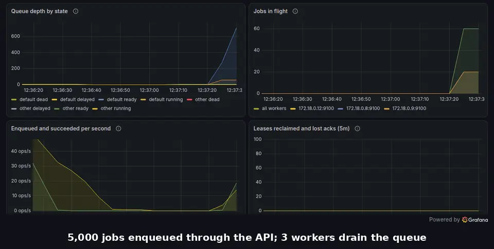
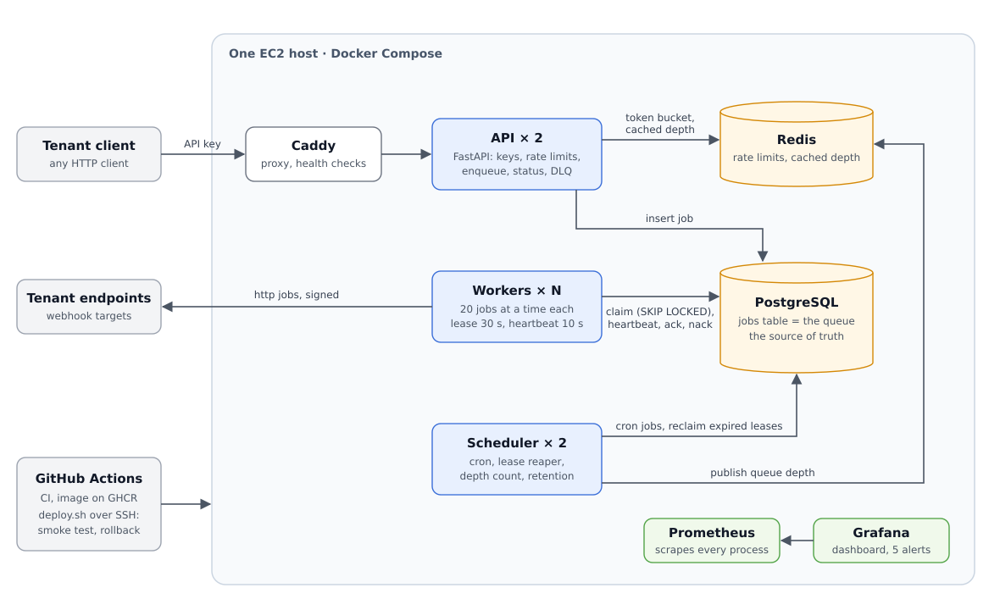

# Hopper

[](https://github.com/Srinu-design/hopper/actions/workflows/ci.yml)

A multi-tenant job queue and scheduler on PostgreSQL. **Send a job over HTTP; Hopper runs it at least once,
retries it with backoff, parks it in a dead-letter queue if it keeps failing, and lets you replay it.** Jobs run now,
after a delay, at a set time, or on a cron schedule.



*Two workers killed in the middle of 5,000 jobs: their leases expire, the reaper hands the jobs to the other
workers, and the queue keeps draining. Nothing is lost.*

## Live demo

- Web page: <http://3.104.222.203/hopper/>. What Hopper is, how to call it, and a console to try it with an API key
- All projects on this server (Hopper and [Sift](https://github.com/Srinu-design/sift)): <http://3.104.222.203/>
- API docs: <http://3.104.222.203/docs>
- Dashboard (read-only): <http://3.104.222.203/grafana/>

The server is a single EC2 instance that runs on demand to save cost. If the links do not answer, it is switched
off; everything also runs locally with one command ([Quickstart](#quickstart)).

## Headline numbers

All measured, with the raw data linked from [docs/benchmarks.md](docs/benchmarks.md):

| | |
|---|---|
| **Throughput** | **600 enqueues/s** held at p95 126 ms; 100,000 jobs drained at **2,773 jobs/s** with 8 workers |
| **Latency** | 300 jobs/s for 10 minutes: API p95 **20 ms**, enqueue to done p95 **254 ms**, 0 errors |
| **Chaos** | 10,000 jobs on the EC2 server, **38 workers killed, 0 jobs lost**; 9 duplicate runs, all harmless |

The same chaos test with workers that ack *before* running (at-most-once) **lost 69 jobs**, and the checks caught
every one. That shows the test can see a loss. A release broken on purpose was **rolled back by itself in 79 s**.

## Architecture



PostgreSQL is both the queue and the source of truth: a job is a row, claimed with `FOR UPDATE SKIP LOCKED` under
a 30 s lease that the worker renews every 10 s. Redis holds only rate-limit buckets and a cached queue depth, so
losing it loses no job. Every process keeps no state and runs one per container. How and why:
[docs/design.md](docs/design.md). Twelve UML diagrams, from use cases to the database and each request:
[docs/diagrams.md](docs/diagrams.md).

## Features, and the test that proves each

| Feature | Proof |
|---|---|
| Each job is claimed by exactly one worker (`SKIP LOCKED`) | [test_claim.py](tests/integration/test_claim.py): 10 claimers, 1,000 jobs, each claimed once |
| `kill -9` a worker mid-job: another finishes it | [test_crash_recovery.py](tests/e2e/test_crash_recovery.py), and the [chaos test](chaos/results/) |
| SIGTERM: finish or release running jobs, exit cleanly | [test_crash_recovery.py](tests/e2e/test_crash_recovery.py), [test_worker_reliability.py](tests/integration/test_worker_reliability.py) |
| A paused worker cannot overwrite a newer run (fencing token) | [test_leases.py](tests/integration/test_leases.py) |
| Retries with full-jitter exponential backoff | [test_retries.py](tests/integration/test_retries.py): every retry inside its window |
| Dead-letter queue, list and replay | [test_dlq_api.py](tests/integration/test_dlq_api.py), [test_dead_letter_and_replay.py](tests/e2e/test_dead_letter_and_replay.py) |
| Idempotency keys | [test_idempotency.py](tests/integration/test_idempotency.py): 50 concurrent requests, 1 job |
| Delayed jobs, set times, cancel | [test_delayed_list_cancel.py](tests/integration/test_delayed_list_cancel.py) |
| Cron with two schedulers, never fired twice | [test_schedules.py](tests/integration/test_schedules.py) |
| One tenant can never see another's jobs | [test_isolation.py](tests/integration/test_isolation.py): every route, with the other tenant's key |
| API keys hashed with a pepper; 15-minute admin JWT | [test_auth.py](tests/unit/test_auth.py), [test_auth_api.py](tests/integration/test_auth_api.py) |
| Rate limits: 429 with `Retry-After`, shared by API replicas | [test_token_bucket.py](tests/integration/test_token_bucket.py), [test_limits_api.py](tests/integration/test_limits_api.py) |
| Backpressure: 429 over a tenant's quota, 503 when overloaded | [test_limits_api.py](tests/integration/test_limits_api.py), [test_depth.py](tests/integration/test_depth.py) |
| Postgres down: 503 with `Retry-After`, not 500 | [test_database_down.py](tests/integration/test_database_down.py) |
| `http` task: SSRF guard and signed requests | [test_http_guard.py](tests/unit/test_http_guard.py), [test_http_task.py](tests/integration/test_http_task.py) |
| Per-tenant internal hosts (platform admin only; metadata endpoint still refused) and a per-job `timeout`, for Sift's ingestion | [test_http_guard.py](tests/unit/test_http_guard.py), [test_http_task.py](tests/integration/test_http_task.py), [test_auth_api.py](tests/integration/test_auth_api.py) |
| At-least-once, and the at-most-once control that loses jobs | [test_negative_control.py](tests/e2e/test_negative_control.py) |
| Metrics and five alerts | [test_metrics.py](tests/integration/test_metrics.py), [alerts_test.yml](deploy/prometheus/alerts_test.yml) |
| Deploy with smoke test and automatic rollback | [test_deploy_script.py](tests/unit/test_deploy_script.py), [rehearse.sh](deploy/rehearse.sh) in CI, the [drill on EC2](https://github.com/Srinu-design/hopper/actions/runs/37630529905) |

Built with Python 3.12, FastAPI, PostgreSQL 16, Redis 7, Prometheus, Grafana, Caddy, Docker Compose, GitHub
Actions and one EC2 instance.

## Stretch: a broker written from scratch

I built the queue on Postgres, then built my own broker and measured both behind one interface.
`src/hopper/minibroker` is a TCP server in Python asyncio that speaks the Redis protocol. It has:

- an append-only log with an fsync knob (`always` with group commit, `everysec`, `no`);
- leases with fencing tokens, retries and a dead-letter queue.

The production `Worker` class runs on it unchanged, and the same 10 contract tests pass on both brokers.

- **About 11,000 msgs/s with fsync every second, versus 3,900 with fsync on every write.** That is a full
  push → pull → ack round trip, at 64 connections. Postgres's best is 1,125 msgs/s, also durable on every write.
- **Chaos:** 38 workers and the broker itself killed during 10,000 jobs: 0 lost. The broker was killed with
  `kill -9` 9 more times while clients pushed: 0 answered pushes lost, in every fsync mode.

Why Hopper still runs on Postgres, and what this broker gives up: [ADR-0012](docs/adr/0012-own-broker.md) and
[benchmarks](docs/benchmarks.md#stretch-the-mini-broker-against-postgres).

## Docs

- [Design](docs/design.md): architecture, delivery semantics, idempotency, what breaks at 10x, failure modes,
  security, limitations
- [Diagrams](docs/diagrams.md): 12 UML diagrams: use cases, components, deployment, classes, the database
  (entity–relationship), job states, five sequences and the failure activity
- [Benchmarks](docs/benchmarks.md): load test, chaos test, rollback drill
- [Chaos reports](chaos/results/) and [load test raw data](loadtest/results/)
- [Deploying to EC2](docs/deploy.md): server setup, first deploy, rollback drill, day to day
- [Demo script](docs/demo.md): the one-minute demo, step by step
- Decision records:
  [0001 Postgres as the queue](docs/adr/0001-postgres-as-queue.md) ·
  [0002 At-least-once delivery](docs/adr/0002-at-least-once-delivery.md) ·
  [0003 Leases, heartbeats, fencing](docs/adr/0003-leases-heartbeats-fencing.md) ·
  [0004 Full-jitter backoff](docs/adr/0004-full-jitter-backoff.md) ·
  [0005 DLQ as a status](docs/adr/0005-dlq-as-a-status.md) ·
  [0006 Idempotency keys](docs/adr/0006-idempotency-keys.md) ·
  [0007 Cron without leader election](docs/adr/0007-cron-without-leader-election.md) ·
  [0008 Redis token bucket, fail open](docs/adr/0008-redis-token-bucket-fail-open.md) ·
  [0009 Backpressure](docs/adr/0009-backpressure-429-503-cached-depth.md) ·
  [0010 API keys and admin JWT](docs/adr/0010-api-keys-and-admin-jwt.md) ·
  [0011 Single-host deploy with rollback](docs/adr/0011-single-host-deploy-with-rollback.md) ·
  [0012 A broker written from scratch](docs/adr/0012-own-broker.md)
- [AI usage notes](docs/ai-usage.md)

## Known limitations

- **One host.** No high availability, and backups are not automated yet.
- **Plain HTTP on the live server**, because it has no domain yet; use only throwaway demo keys there. Caddy
  switches to HTTPS by itself once a domain is set.
- **No fairness between tenants.** Rate limits and quotas cap what a tenant sends, but workers pick jobs by
  priority and age, not by tenant.
- **About 35 s to recover** a crashed worker's job (lease plus reaper interval).
- **Workers poll** the database; `LISTEN/NOTIFY` would wake them instead.
- **The load test ran on a laptop**, sharing it with the load generator; the chaos test and the rollback drill ran
  on the EC2 server.

More, with the fixes for each: [design.md, section 8](docs/design.md#8-limitations-and-future-work).

## Quickstart

Requirements: Docker with the Compose plugin. For development also [uv](https://docs.astral.sh/uv/).

```bash
cp .env.example .env         # includes development-only secrets; generate your own for anything real
make up                      # Postgres + Redis, migrations, the API, 3 workers, 2 schedulers, Prometheus, Grafana
curl localhost:8000/healthz  # {"status":"ok"}
curl localhost:8000/readyz   # {"status":"ok","checks":{"postgres":"ok","redis":"ok"}}
# Grafana: http://localhost:3000 opens the Hopper dashboard (view without logging in; admin password in .env)
# Prometheus: http://localhost:9090 (Alerts page: QueueBacklog, HighFailureRate, DLQGrowing, NoWorkers, NoScheduler)

# 1. create the first platform admin (asks for a password, 12+ characters)
docker compose -f docker/compose.yaml --env-file .env run --rm api python -m hopper.bootstrap --email admin@example.com

# 2. log in, and create a tenant with its owner. The response's signing_secret is shown once:
#    keep it to verify the Hopper-Signature header on http task calls. Limits are optional:
#    rate_per_sec (50) and burst (100) for the token buckets, max_queue_depth (100000) for backpressure.
curl -X POST localhost:8000/auth/token -H 'content-type: application/json' -d '{"email":"admin@example.com","password":"<password>"}'
curl -X POST localhost:8000/admin/tenants -H 'Authorization: Bearer <admin token>' -H 'content-type: application/json' \
  -d '{"name":"acme","rate_per_sec":50,"burst":100,"owner":{"email":"ops@acme.example","password":"<owner password>"}}'

# 3. as the owner, create an API key (shown once) and use it for everything under /v1
curl -X POST localhost:8000/auth/token -H 'content-type: application/json' -d '{"email":"ops@acme.example","password":"<owner password>"}'
curl -X POST localhost:8000/admin/api-keys -H 'Authorization: Bearer <owner token>' -H 'content-type: application/json' -d '{"name":"my app"}'
KEY='Authorization: Bearer hop_live_...'   # the "key" field from the response
J='content-type: application/json'

# enqueue a job now, after a delay, or at a set time (at most 30 days out), then check on it.
# -i shows X-RateLimit-Limit and X-RateLimit-Remaining; past the burst you get 429 with Retry-After.
curl -i -X POST localhost:8000/v1/jobs -H "$KEY" -H "$J" -d '{"task":"sleep","payload":{"ms":100}}'
curl -X POST localhost:8000/v1/jobs -H "$KEY" -H "$J" -d '{"task":"sleep","payload":{"ms":100},"delay_seconds":30}'
curl -X POST localhost:8000/v1/jobs -H "$KEY" -H "$J" -d '{"task":"sleep","payload":{"ms":100},"run_at":"2026-11-01T09:00:00+05:30"}'
curl localhost:8000/v1/jobs/<id> -H "$KEY"                   # status, result and attempt history
curl "localhost:8000/v1/jobs?status=queued" -H "$KEY"        # newest first; ?queue=&limit=&cursor=
curl -X POST localhost:8000/v1/jobs/<id>/cancel -H "$KEY"    # only while still queued

# safe to retry: the same Idempotency-Key and body return the same job (200, Idempotent-Replayed: true)
curl -X POST localhost:8000/v1/jobs -H "$KEY" -H "$J" -H 'Idempotency-Key: order-42' -d '{"task":"sleep","payload":{"ms":100}}'

# cron: five fields, in the schedule's own time zone; PATCH turns it off and on
curl -X POST localhost:8000/v1/schedules -H "$KEY" -H "$J" \
  -d '{"name":"morning-report","cron":"0 9 * * 1-5","timezone":"Asia/Kolkata","task":"sleep","payload":{"ms":10}}'
curl localhost:8000/v1/schedules -H "$KEY"
curl -X PATCH localhost:8000/v1/schedules/<id> -H "$KEY" -H "$J" -d '{"enabled":false}'

# the http task: Hopper calls your URL with the body, signed, and retries on 408, 429 and 5xx
curl -X POST localhost:8000/v1/jobs -H "$KEY" -H "$J" -d '{"task":"http","payload":{"url":"https://example.com/","method":"GET"}}'

# fill the dead-letter queue, look at it, replay
curl -X POST localhost:8000/v1/jobs -H "$KEY" -H "$J" -d '{"task":"fail_always","payload":{"permanent":true}}'
curl localhost:8000/v1/dlq -H "$KEY"                         # ?queue=&task=&since=&limit=&cursor=
curl -X POST localhost:8000/v1/jobs/<id>/replay -H "$KEY"    # one job, runs now
curl -X POST localhost:8000/v1/dlq/replay -H "$KEY" -H "$J" -d '{"filter":{"task":"fail_always"},"spread_seconds":60}'

# crash recovery: kill -9 the worker running a job, and another worker finishes it within about 35 s
curl -X POST localhost:8000/v1/jobs -H "$KEY" -H "$J" -d '{"task":"sleep","payload":{"ms":20000}}'
docker compose -f docker/compose.yaml --env-file .env exec postgres psql -U hopper -c "select id, lease_owner from jobs where status = 'running'"
docker kill <container id>         # the part of lease_owner before the first dash, e.g. 6a07c0d4678c
curl localhost:8000/v1/jobs/<id> -H "$KEY"   # attempt_history: lease_expired on the dead worker, then succeeded

# graceful shutdown: running jobs get up to 25 s, the rest go back to the queue with no attempt used
docker compose -f docker/compose.yaml --env-file .env stop worker
```

Built-in tasks: `sleep` (`{"ms": 100}`), `flaky` (`{"p": 0.3}` fails with that probability), `fail_always`
(`{}` retries until it is dead; `{"permanent": true}` goes to the DLQ at once) and `http` (`{"url", "method",
"headers", "body", "timeout"}`; 8 attempts, 10 s backoff base, 1 h cap; each call waits 5 s to connect and 10 s
to read, or `timeout` seconds to read, up to 120; the job's own deadline is 130 s). Admin tokens last 15
minutes, and `/auth/token` allows 10 attempts per email, then one every 6 s. The development stack is plain HTTP,
so keep it on localhost; on a server, Caddy terminates HTTPS ([docs/deploy.md](docs/deploy.md)). Scale workers
with `docker compose -f docker/compose.yaml --env-file .env up -d --scale worker=N`; Prometheus finds new replicas
by itself within 10 s.

| Answer | When | What to do |
|---|---|---|
| 429 `rate_limited` | the tenant's token bucket for this route class is empty | wait `Retry-After` seconds (`retry_after_ms` in the body) |
| 429 `queue_quota_exceeded` | the tenant already has `max_queue_depth` jobs queued (enqueue and replay only) | retry once some have run |
| 503 `overloaded` | all tenants together have `GLOBAL_MAX_QUEUE_DEPTH` jobs queued | retry after `Retry-After` |
| 503 `database_unavailable` | Postgres cannot be reached | retry after `Retry-After` (5 s) |

Without `make` (for example on Windows), run what `make up` runs:

```bash
cp .env.example .env
docker compose -f docker/compose.yaml --env-file .env up -d --build   # the API, workers and schedulers wait for migrate
```

`make down` stops the stack; add `-v` to the compose `down` to also delete the Postgres and Redis volumes.
API docs are served at <http://localhost:8000/docs>.

## Development

```bash
uv sync                # install from uv.lock
docker compose -f docker/compose.yaml --env-file .env up -d postgres redis
make test              # pytest against real Postgres and Redis
make lint              # ruff check, ruff format --check, mypy --strict on src/
make fmt               # ruff format, then ruff check --fix
make migrate           # alembic upgrade head from the host, with the settings in .env
make alerts            # promtool: check the Prometheus config and unit-test the alert rules
make rehearse          # deploys, broken releases and rollbacks on a throwaway Docker host (deploy/rehearse.sh)
make chaos             # 10,000 jobs while workers are killed for 5 minutes, then SQL checks (about 7 minutes)
make chaos-control     # the same with workers that ack before running: it must lose jobs
make demo              # the one-minute demo, one step per Enter (docs/demo.md)
make broker-bench      # the mini broker against the Postgres broker, about 12 minutes
make broker-chaos      # workers and the mini broker itself killed, about 10 minutes
make load              # load scenario A (enqueue throughput); make bench runs A to D, about two hours
make diagrams          # draw docs/diagrams.md as SVG for the web page (needs Chrome and Mermaid 11)
```

Production runs `docker/compose.prod.yaml` on one EC2 host, deployed by GitHub Actions through `deploy/deploy.sh`.
Setting up the server, the GitHub secrets, the first deploy and the rollback drill: [docs/deploy.md](docs/deploy.md).

Tests use real Postgres and Redis, because mocks cannot prove `SKIP LOCKED` behaviour. Integration tests
create a throwaway database per test, so they never touch your dev data. Host-side URLs use `127.0.0.1`,
not `localhost`: on Windows `localhost` resolves to `::1` first and the published ports are IPv4 only.

## Layout

| Path | Contents |
|---|---|
| `src/hopper/` | `api/` (routers, rate limits and backpressure, HTTP metrics), `auth/` (API keys, passwords, JWT, tenant context), `ratelimit/` (`token_bucket.lua`, the limiter and its in-process fallback, the depth gate), `queue/` (Broker interface and all queue SQL), `worker/` (run loop, heartbeats, shutdown), `scheduler/` (cron, reaper, queue-depth and retention loops), `tasks/` (registry, built-ins, `http`, `effect` for the chaos test), `minibroker/` (the stretch goal: a broker written from scratch, its client and a worker on it), `web/` (Hopper's page, at `/` on the API and `/hopper/` on the server: about, how to use it, and the console), `bootstrap.py` (first admin, deploy smoke key, load-test key), `metrics.py`, `config.py`, `logging.py`, `db.py` |
| `migrations/` | Alembic revisions. Hand-written SQL, backward compatible with the previous release |
| `docker/` | `Dockerfile` (one image, every role, carrying its deploy bundle), `compose.yaml` (development) and `compose.prod.yaml` (the server) |
| `deploy/` | `deploy.sh` (deploy, smoke test, rollback), `smoke.py`, `host-setup.sh` (one-time server setup), `rehearse.sh` and `rehearse-local.sh`, `broken/` (releases broken on purpose for drills), `Caddyfile`, `prometheus/` (config, alerts and their tests), `grafana/provisioning/` (data source, dashboard JSON), `site/` (the portfolio home page the server shows at `/`) and `site-src/` (its Tailwind sources; the rebuild command is in `tailwind.config.js`) |
| `.github/workflows/` | `ci.yml` (lint, alerts, tests, delivery rehearsal; the image, on pushes to main only), `deploy.yml` (main to the server), `drill.yml` (rollback drill), `nightly-chaos.yml` (the chaos test every night, either mode on demand) |
| `tests/` | `unit/`, `integration/`, `e2e/` |
| `loadtest/` | `bench.py` (scenarios A to D with k6 in Docker, three runs each), `k6/enqueue.js`, `compose.bench.yaml` (a second API replica), `broker_bench.py` and `broker_client.py` (the mini broker against Postgres), `results/` (summaries and raw k6 output) |
| `chaos/` | `kill_workers.py` (the chaos test), `compose.ack-before-run.yaml` (the negative control), `on-server.sh` (the same test on the server), `demo.py` (the one-minute demo), `broker_chaos.py` (the chaos test for the mini broker), `results/` (reports) |
| `docs/` | `design.md`, `diagrams.md` (the UML diagrams; `render_diagrams.py` draws them as SVG for the web page), `benchmarks.md`, `demo.md` (the demo script), `deploy.md`, `changelog.md`, `adr/` (decision records), `images/`, `delivery/` (a rehearsal log), `ai-usage.md` |

## Changelog

Week by week, from the skeleton to the stretch broker, the web page and hosting Sift:
[docs/changelog.md](docs/changelog.md).
